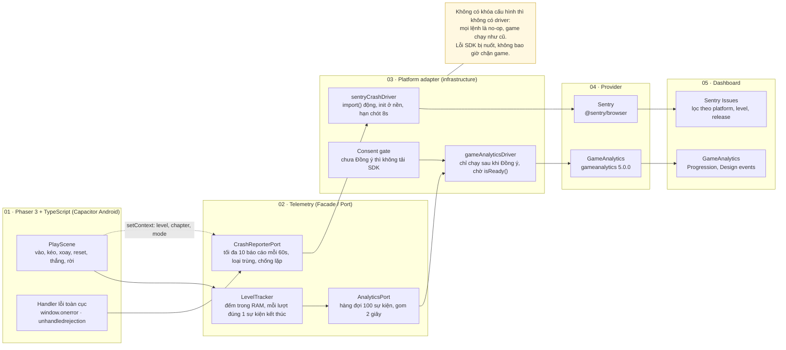

# Slide 25 · Kiến trúc triển khai thực tế (Nozvi)

Nội dung điền vào placeholder của `image.png`: sơ đồ kiến trúc và 5 ô thông tin bên phải.

## Sơ đồ kiến trúc

## Thông tin bên phải slide

| Ô trên slide | Nội dung |
| --- | --- |
| Tên game / project | Nozvi (Mirror puzzle) · Phaser 3 + TypeScript + Vite · Capacitor Android · v1.0.0 |
| Error capture layer | `installGlobalErrorHandlers` (`error`, `unhandledrejection`) + `CrashReporterPort.capture` |
| SDK configuration | `VITE_SENTRY_DSN`, `VITE_GA_GAME_KEY`, `VITE_GA_SECRET_KEY` trong `.env.local` (đọc lúc build). Sentry: `release` = `APP_VERSION`, `environment` = mode build, `sendDefaultPii` = false, tag `platform` / `native` / `level` / `chapter` / `mode` |
| Provider đã chọn | Sentry (crash) + GameAnalytics (tracking). Slide mẫu ghi PostHog nhưng dự án không dùng |
| Reporting workflow | Lỗi JS → Sentry Issues (chưa có source map). Start / complete / abandon → GameAnalytics Progression + Design (Moves, Resets, Abandon) |
